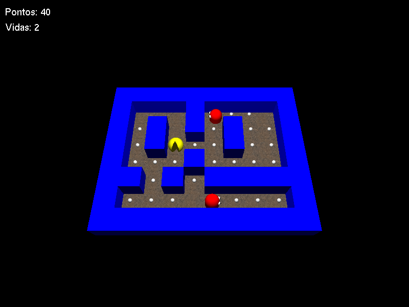

# Pac-Man 3D

Jogo no estilo Pac-Man feito em **Python + OpenGL** para a disciplina de **Computação Gráfica** (Ciência da Computação, UTP, Prof. Diógenes Furlan), Avaliação Principal do 2º Bimestre: *Criação de Ambientes Virtuais*.

É um **jogo 2D construído com técnicas 3D**: toda a lógica acontece numa grade lida de um arquivo texto, mas o desenho é tridimensional, com paredes em cubos, iluminação, textura no chão e duas câmeras.



## Como rodar

Requisitos: Python 3 e as bibliotecas abaixo.

```bash
pip install PyOpenGL PyOpenGL_accelerate Pillow
python main.py
```

> **Windows:** se `glutInit()` der `NullFunctionError`, faltam as DLLs do freeglut. Instale uma versão do PyOpenGL que já traga o freeglut ou coloque o `freeglut.dll` (64 bits) na pasta do projeto.

## Controles

| Tecla | Ação |
|---|---|
| `ENTER` | Começa o jogo / sai do pause |
| Setas | Movem o Pac-Man |
| `P` | Pausa |
| `C` | Alterna a câmera (visão de cima / seguindo o Pac-Man) |
| `R` | Recomeça (no Game Over ou na Vitória) |
| `ESC` | Fecha o jogo |

## Como jogar

Colete todas as moedas do labirinto fugindo dos fantasmas. Cada moeda vale 10 pontos; encostar num fantasma custa uma vida. Com as 3 vidas perdidas é **Game Over**; com todas as moedas coletadas, **Vitória**.

## Máquina de estados

```
Inicio --ENTER--> Jogando --P--> Pause --ENTER--> Jogando
                  Jogando --vidas = 0--> GameOver --R--> Inicio
                  Jogando --moedas = 0--> Vitoria --R--> Inicio
```

## Técnicas utilizadas

- **GLUT e callbacks:** janela, teclado (`glutKeyboardFunc`, `glutSpecialFunc`) e animação (`glutTimerFunc`, ~60 Hz), com double buffering.
- **Cenário em arquivo texto:** `fase1.txt` define paredes (`#`), moedas (`.`), Pac-Man (`P`) e fantasmas (`E`).
- **Formas 3D:** paredes com `glutSolidCube`, posicionadas com `glPushMatrix` / `glTranslatef` / `glPopMatrix`.
- **Pac-Man modelado à mão:** esfera construída vértice a vértice com `GL_QUAD_STRIP` (20 "rodelas" × 20 "gomos"), deixando um gomo de fora para formar a boca, que abre e fecha com `sin()` e gira para a direção do movimento.
- **Fantasmas:** modelo hierárquico (esfera + cilindro + olhos), flutuação com `sin()`, movimento suave entre casas (interpolação) e escolha de direção em cada cruzamento.
- **Colisão em grade:** objeto × parede, Pac-Man × moeda e Pac-Man × fantasma.
- **Câmera:** `gluPerspective` + `gluLookAt`, com visão geral e câmera que segue o jogador.
- **Iluminação:** `GL_LIGHTING`, `GL_LIGHT0` e `GL_COLOR_MATERIAL`, com a lâmpada posicionada acima do mapa.
- **Textura:** imagem carregada com Pillow e aplicada ao chão com `glTexImage2D` e `GL_REPEAT`.
- **HUD:** texto com `glutBitmapCharacter` em projeção ortográfica (`gluOrtho2D`).

Não foram usadas as bibliotecas PyGame nem OpenCV, conforme o enunciado.

## Estrutura

```
main.py      código do jogo
fase1.txt    mapa da fase
chao.jpg     textura do chão
```

| Função | Responsabilidade |
|---|---|
| `inicializar()` | Profundidade, projeção, iluminação e textura (uma vez) |
| `carregar_mapa()` | Lê a fase e monta mapa, jogador, fantasmas e moedas |
| `draw()` | Desenha cada quadro conforme o estado |
| `desenhar_pacman()` | Esfera do Pac-Man com a boca |
| `timer()` | Animação: move fantasmas, checa colisões e vitória |
| `mover_fantasmas()` | Movimento autônomo dos fantasmas |
| `checar_colisao_fantasma()` | Perda de vidas e Game Over |
| `teclado()` / `teclas_especiais()` | Estados, câmera e movimento do Pac-Man |
| `desenhar_texto()` | Texto na tela (HUD) |

## Autor

**Vicente Rafael Carvalho do Valle**, Ciência da Computação, Universidade Tuiuti do Paraná.

Referência de ideia: vídeo *Crie um Pac-Man em Python com Pygame* (YouTube), do qual foi aproveitada apenas a lógica em grade; a implementação é em OpenGL. Um assistente de IA (Claude) foi usado como apoio para explicação de conceitos e depuração; o código foi escrito pelo autor.
